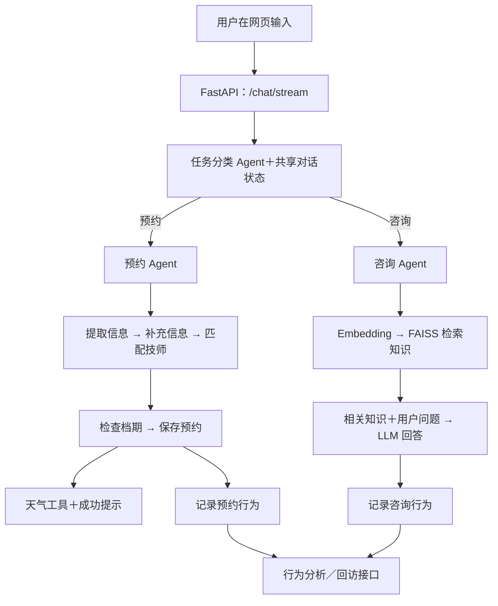

# 项目流程与技术分析

> 本文主体为 2026-11-25 的源码分析快照。2026-11-26 已完成代码清理：移除了失效业务 API、未使用的 Recorder/PreferenceManager、空转推荐调度和内存排班副本；知识管理与聊天共用索引，确认过意图的咨询不再二次分类。当前实现以源码和 README 的“代码清理更新”为准。

本文依据本地源码整理，记录日期：2026-11-25。

项目通过大模型理解用户输入，由 Python 业务代码执行预约、检索和数据操作，再通过自写状态机协调不同 Agent。主要技术包括 LangChain、FastAPI、FAISS、SQLite 和 SQLAlchemy。

## 1. Agent 数量与职责

项目包含 **4 个业务 Agent**。预约 Agent 内部还嵌入了一个调用天气工具的 LangChain Agent。

| Agent | 职责 | 实现方式 | 源码入口 |
|---|---|---|---|
| TaskClassificationAgent：任务分类 | 判断用户意图，分发请求，协调对话状态 | LLM 分类 + StateManager + AgentRouter | [task_classification_agent.py](agents/task_classification_agent.py) |
| AppointmentAgent：预约 | 收集预约信息、寻找技师、检查档期、保存预约 | LLM 信息抽取 + 多轮信息补齐 + Python 业务逻辑 | [appointment_agent.py](agents/appointment_agent.py) |
| ConsultantAgent：咨询 | 回答价格、营业时间、地址和服务介绍等问题 | 检索知识库 + 提示词拼接 + LLM 回答 | [consultant_agent.py](agents/consultant_agent.py) |
| UserBehaviorAgent：用户行为分析 | 记录行为、统计偏好、生成回访邀请 | Python 频次统计 + 档期查询 + LLM 文案生成 | [user_behavior_agent.py](agents/user_behavior_agent.py) |

这些 Agent 是职责不同的 Python 对象，可以调用同一个聊天模型。分析时，本地配置通过阿里云兼容接口调用 `deepseek-v4.1-flash`，Embedding 使用 `text-embedding-v3`；具体配置以 `.env` 为准。

聊天入口直接创建分类、预约、咨询三个 Agent，并共享一个会话 ID。用户行为分析通过行为记录和独立接口参与。参见 [api/chat_handler.py](api/chat_handler.py)。

## 2. 整体请求流程



主要调用关系：

```text
浏览器 fetch('/chat/stream')
  → web/routes.py：chat_stream_endpoint()
  → api/chat_handler.py：ProcessUserInput_stream()
  → TaskClassificationAgent.classify_task_stream()
  → ClassificationProcessor.process_task_stream()
  → 根据分类结果或当前状态，进入预约或咨询流程
  → 通过异步生成器返回文本片段
  → 浏览器读取响应并更新聊天内容
```

服务启动时，[app.py](app.py) 还会初始化默认知识库、初始化默认技师，并启动推荐调度线程。

## 3. 分类与调度流程

### 3.1 使用 LLM 判断意图

例如用户输入“我想预约明天下午三点的肩颈按摩”，分类器将输入填入 `PromptTemplate`，要求模型只返回类别英文名。

核心代码：

```python
self.chain = self.prompt | self.llm
category_msg = await self.chain.ainvoke({"task": task})
```

`|` 是 LangChain 的链式组合：先填充提示词，再调用模型。模型输出经过清理和类别校验后，交给 Python 分支处理。

源码：[task_classifier.py](agents/task_classification/task_classifier.py)。

### 3.2 使用状态机保持业务连续性

主要状态定义在 [config/constants.py](config/constants.py)：

| 状态 | 含义 |
|---|---|
| CLASSIFY | 等待识别用户意图 |
| APPOINTMENT | 正在收集和处理预约信息 |
| CONSULT | 正在处理咨询 |

在 CLASSIFY 状态下，系统调用模型识别意图；进入预约后，用户下一句即使只有“30分钟”或“女技师”，也会根据 APPOINTMENT 状态继续交给预约 Agent。业务完成后再回到分类状态。

编排由作者编写的 `StateManager`、`ClassificationProcessor` 和 `AgentRouter` 实现。

相关源码：

- [state_manager.py](agents/task_classification/state_manager.py)
- [classification_processor.py](agents/task_classification/classification_processor.py)
- [agent_router.py](agents/task_classification/agent_router.py)

分类提示词包含 appointment、query、pay、statistics 和 other，但当前路由实际只接通预约和咨询两个业务分支。支付和统计类别会进入暂不支持的处理逻辑。

## 4. 预约 Agent 流程

### 4.1 将自然语言转换为结构化字段

模型提取的信息类似：

```json
{
  "start_time": "具体日期 15:00",
  "project": "肩颈按摩",
  "duration": "30分钟",
  "gender": "女",
  "preference": "手法轻",
  "technician_name": "未知"
}
```

其中时间示例仅用于说明字段，实际模型输出应为 `YYYY-MM-DD HH:MM`。

实现方式是通过提示词要求模型输出纯 JSON，再用 `json.loads()` 解析。目前没有使用严格的结构化输出校验；解析失败会返回一组“未知”字段。

源码：[input_parser.py](agents/appointment/input_parser.py)。

### 4.2 保存多轮对话与已收集信息

预约 Agent 使用两种状态：

- `InMemoryChatMessageHistory`：保存用户消息和模型返回的 JSON，整理成文本供后续模型调用参考。
- `appointment_history` 字典：保存时间、项目、时长、性别、偏好和技师等结构化字段。

新一轮提取到的有效字段会合并到字典中，避免缺失字段覆盖已经收集的信息。

必需信息规则：

- 指定了技师姓名：需要时间、项目和时长。
- 没指定技师姓名：还需要技师性别。
- 信息缺失：询问用户补充。
- 信息齐全：进入技师匹配和档期检查。

源码：[appointment_agent.py](agents/appointment_agent.py)、[appointment_processor.py](agents/appointment/appointment_processor.py)。

### 4.3 根据姓名或语义偏好匹配技师

| 用户需求 | 处理方式 |
|---|---|
| 指定某位技师 | 按姓名查询数据库，再检查档期 |
| 只给出性别和偏好 | 按性别筛选，再按专长与偏好的向量相似度排序，依次检查档期 |
| 指定技师没有空 | 根据该技师专长寻找相似且空闲的技师，并等待用户确认替换 |

语义匹配的实现：

```text
用户偏好／目标技师专长
  → Embedding 向量
候选技师的专长描述
  → Embedding 向量
  → NumPy float32 数组
  → FAISS IndexFlatL2
  → 按距离返回候选技师的排序
  → 依次检查是否有空
```

源码：[technician_finder.py](agents/appointment/technician_finder.py)、[services/text_embedding.py](services/text_embedding.py)。

### 4.4 检查时间冲突与保存预约

数据库检查已有忙碌时段是否与新预约重叠：

```python
已有预约.start_time < 新预约.end_time
已有预约.end_time > 新预约.start_time
```

两个条件同时成立，表示有时间冲突。找到可用技师后，系统向 `technician_schedules` 表插入 `busy` 排班记录，同时记录预约行为，并更新进程内的忙碌时段字典。

当前普通预约在信息齐全、技师可用后会直接保存；推荐替换技师时才有专门的确认步骤。

相关源码：

- [technician_repository.py](db/repositories/technician_repository.py)：档期冲突查询。
- [appointment_service.py](services/appointment_service.py)：保存忙碌排班。
- [appointment_database.py](agents/appointment/appointment_database.py)：保存预约后记录行为、更新内存状态。

## 5. 咨询 Agent 与 RAG

例如用户问“肩颈按摩多少钱”，处理流程如下：

```text
判断输入是否属于店铺咨询
  → 将用户问题转换为向量
  → FAISS 检索相关知识，默认取 3 条
  → 拼接回答要求、知识内容和用户问题
  → 调用 LLM 生成回答
  → 记录咨询行为
```

### 5.1 知识存储与向量检索

初始化知识库时，系统会把营业时间、服务价格、门店地址等默认知识及关键词转换为向量。

- SQLite 保存原文、分类、关键词和向量。
- 向量以 JSON 字段保存在 `knowledge_documents.embedding` 中。
- FAISS 在内存中构建 `IndexFlatIP`，按向量内积检索。
- 查询时先取最多 `top_k × 2` 个候选，再按可选分类条件过滤，截取所需数量。

源码：[knowledge_service.py](services/knowledge_service.py)、[knowledge_retriever.py](agents/consultant/knowledge_retriever.py)、[db/models.py](db/models.py)。

### 5.2 将检索结果交给大模型

提示词的结构大致是：

```text
你是推拿房前台，请基于提供的信息回答。

相关知识：
1. 肩颈推拿80元／30分钟。
2. ……

用户问题：肩颈按摩多少钱？
```

随后使用 `llm.ainvoke()` 生成答案。Embedding 负责查找相关资料，聊天模型负责组织语言。

当前提示词允许模型用一般知识补充回答，因此生成内容不完全受知识库约束。

源码：[prompt_builder.py](agents/consultant/prompt_builder.py)、[response_generator.py](agents/consultant/response_generator.py)、[consultation_processor.py](agents/consultant/consultation_processor.py)。

## 6. 天气工具与 Function Calling

预约保存成功后，系统会尝试获取天气并生成温馨提示。这里使用了 LangChain 的工具调用 Agent：

```python
weather_agent = create_openai_tools_agent(llm, tools, prompt)
agent_executor = AgentExecutor(agent=weather_agent, tools=tools)
```

流程：

```text
模型收到查询天气并生成提示的任务
  → 模型产生 get_current_weather 工具调用
  → AgentExecutor 执行 Python 工具
  → 工具返回结果
  → 模型根据结果生成成功提示
```

工具继承 `BaseTool`，通过 `_arun()` 执行异步请求。

**实现边界：**虽然类名叫 `WeatherMCPTool`，实际代码使用 `aiohttp` 直接访问 OpenWeather HTTP API，这条链路没有经过 MCP 协议。分析时本地未配置天气密钥，工具会返回代码内置的天气文案，不能作为实时天气使用。

源码：[appointment_processor.py](agents/appointment/appointment_processor.py)。

## 7. 用户行为分析与回访

### 7.1 行为记录

预约、咨询发生后，系统记录行为类型、时间、技师、会话及相关内容。预约主要通过服务层记录，咨询流程会调用用户行为 Agent 记录。

### 7.2 偏好分析

偏好分析主要使用 Python 频次统计：

| 统计项目 | 计算方式 |
|---|---|
| 偏爱技师 | 预约记录中出现次数最多的技师 |
| 常用服务 | 出现次数最多的服务项目 |
| 常用时长 | 出现次数最多的服务时长 |
| 是否建议回访 | 至少两次预约，且距离最近一次预约行为记录达到阈值，默认 30 天 |

这里的“距离最近一次”依据行为记录的创建时间计算。偏好计算主要由规则完成，LLM 负责文案生成。

源码：[pattern_analyzer.py](agents/user_behavior/pattern_analyzer.py)。

### 7.3 生成个性化邀请

回访接口查询偏爱技师今天、明天的空闲时间，将技师姓名、专长、常用项目、时长和空闲时段放入提示词，再让 LLM 生成邀请文案。

`/api/user-behavior/send-reminder` 目前生成并返回文案。后台虽然启动了 `schedule` 定时线程，但定时推荐函数的核心仍是 TODO，尚未形成自动推荐、自动触达的完整流程。

源码：[user_behavior_agent.py](agents/user_behavior_agent.py)、[user_behavior_analysis.py](api/user_behavior_analysis.py)、[recommendation_service.py](services/recommendation_service.py)。

## 8. 技术与具体实现对照

| 技术 | 项目中的实现 |
|---|---|
| FastAPI + Pydantic | 定义网页和 API 路由，解析请求 JSON，校验接口字段，生成 `/docs` |
| LangChain | PromptTemplate 构造提示词，`prompt \| llm` 组合调用链，保存预约聊天历史，执行天气工具调用 |
| OpenAI 兼容接口 | ChatOpenAI、OpenAIEmbeddings 封装模型调用，通过模型名、Base URL 和密钥切换服务 |
| FAISS + NumPy | 将向量转为 float32；知识检索使用 IndexFlatIP，技师匹配使用 IndexFlatL2 |
| SQLite + SQLAlchemy | ORM 管理技师、排班、知识、行为、偏好和推荐等表 |
| SessionManager | 使用会话上下文管理事务提交、异常回滚及会话关闭 |
| Jinja2 + 原生 JavaScript | 后端渲染 HTML，前端通过 fetch 发送聊天请求 |
| StreamingResponse | 通过异步生成器返回文本片段，前端用 getReader、TextDecoder 逐步读取 |
| python-dotenv | 加载 `.env`，并引用现有环境变量中的密钥 |
| schedule + threading | 在后台线程中定期检查任务；推荐任务的业务逻辑仍待补全 |

主要工程源码：

- [config/model_provider.py](config/model_provider.py)：聊天模型与 Embedding 工厂。
- [db/models.py](db/models.py)：SQLAlchemy 表结构。
- [db/base/session_manager.py](db/base/session_manager.py)：数据库会话和事务。
- [web/routes.py](web/routes.py)：网页、聊天接口和 StreamingResponse。
- [web/templates/index.html](web/templates/index.html)：浏览器请求和响应读取。

## 9. 理解当前实现时需要注意的边界

1. **业务 Agent 与工具调用 Agent 层次不同。** 四个业务 Agent 负责不同功能；预约内部还有一个天气工具调用 Agent。主流程由自写状态机和路由器编排。
2. **咨询的流式回复在完整生成后逐字符发送。** ResponseGenerator 先等待 `ainvoke()` 返回完整答案，再逐字符 `yield`；预约信息抽取使用模型 `.stream()`，但会先收集完整 JSON 再处理业务。
3. **当前会话按单用户场景实现。** 聊天入口使用全局 Agent 和全局会话 ID，行为记录统一使用 `default_user`；不同浏览器访问可能共享状态。
4. **聊天记忆与持久化数据不同。** 预约聊天历史保存在进程内存，重启会清空；排班、知识向量和行为数据保存在 SQLite。
5. **天气数据存在固定文案回退。** 未配置天气密钥或请求失败时，不会得到可靠的实时天气。
6. **自动推荐调度尚未完成业务闭环。** 调度线程可以运行，但定时推荐函数当前返回空结果；回访接口主要用于生成和返回文案。
7. **技师向量缓存函数尚未接入匹配主链路。** text_embedding.py 定义了保存和读取 pickle 缓存的函数，但技师匹配仍在调用时逐条生成候选向量并构建索引。知识库向量则已保存在 SQLite 中供后续加载。

## 10. 建议源码阅读顺序

1. [api/chat_handler.py](api/chat_handler.py)：看三个聊天 Agent 如何创建和连接。
2. [classification_processor.py](agents/task_classification/classification_processor.py)：理解状态和请求分发。
3. [appointment_agent.py](agents/appointment_agent.py)：理解多轮信息收集，再沿调用进入预约处理器和技师查找器。
4. [knowledge_service.py](services/knowledge_service.py)：理解知识向量如何存储、建索引和检索。
5. [user_behavior_agent.py](agents/user_behavior_agent.py)：理解偏好分析和回访文案如何组合。

实际体验时，可以在首页输入“你们每天几点开门、几点关门？”观察咨询流程，再输入“我想预约明天下午三点的肩颈按摩”观察预约信息追问。补齐预约信息可能直接保存预约，建议使用测试数据。
